# ShopEase: E-commerce QA, API Testing & Security Validation

A fictional e-commerce web application (Flask + SQLite) built as a **hands-on portfolio project** for Software QA and basic application-security testing: test design, manual and automated testing, REST API checks, SQL validation, browser DevTools investigation, bug reporting and local-only security validation.

> **Local educational / portfolio project.** All data is fictional. It is **not** a certified security audit or penetration test, and nothing here should be run against systems you do not own.

## Objectives
- Practise the full tester workflow on one small system: requirements -> scenarios -> test cases (equivalence partitioning, boundary values) -> execution -> defects -> report.
- Demonstrate API testing with pytest + `requests` and Postman, database validation with SQL, and evidence-based reporting.
- Demonstrate entry-level security thinking: authentication, sessions, authorization (IDOR, role checks), input validation, price tampering, headers and information disclosure.
- Report honestly: separate what was executed from what was only designed, and confirmed issues from potential risks.

## Scope
| QA scope | Security scope (local only) |
|---|---|
| Registration, login/logout, product search, cart (add/update/remove), quantity limits, subtotal/shipping/total calculation, simulated checkout, order history and cancellation, API status codes and error shape | 401/403/404 behaviour, access to another user's order, unauthorised cancellation, admin endpoint, role/user-id manipulation, server-side session invalidation, invalid/tampered cookies, server-side price validation, malformed input, security headers, error leakage |

## Technology stack (from the repository)
Python 3 - Flask 3 / Werkzeug 3 - SQLite (`sqlite3`) - HTML/CSS/vanilla JavaScript - pytest 8 - `requests` - Postman - `sqlite3` CLI - Git/GitHub - Chrome/Firefox DevTools.

## Architecture
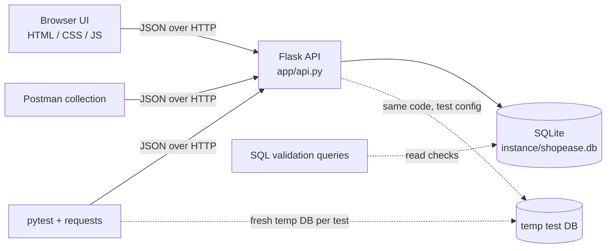

## Directory structure
```
ShopEase-QA-Security-Testing/
├── app/                 Flask application (api.py, auth.py, db.py, seed.py, templates/, static/)
├── tests/               pytest suite (conftest + 8 test files, incl. test_id_range.py for BUG-002)
├── scripts/             replay_manual_cases.py: API-level replay of the manual and security cases
├── docs/                test plan, scenarios, cases, execution report, evidence index, bug reports,
│                        security test cases/report/findings, API/SQL/DevTools guides, portfolio docs,
│                        evidence/ (replay output, SQL check)
├── postman/             collection (45 requests) and local environment
├── sql/                 qa-validation-queries.sql
├── screenshots/         supporting evidence (sanitized/ holds public-safe copies; private/ is git-ignored)
├── run.py  pytest.ini  requirements.txt  config.example  .gitignore  LICENSE
```

## Installation and local setup (Linux / Kali)
```bash
sudo apt update && sudo apt install -y python3 python3-venv python3-pip sqlite3 git
git clone https://github.com/SnehaCipherShell/ShopEase-QA-Security-Testing.git
cd ShopEase-QA-Security-Testing
python3 -m venv .venv
source .venv/bin/activate
python -m pip install --upgrade pip
pip install -r requirements.txt     # recorded run used Python 3.14.6 and pytest 8.4.2
python -m app.init_db --reset      # creates instance/shopease.db with fictional seed data
```
Local test-only accounts (documented seed data, not real credentials): `alice / AlicePass123`, `bob / BobPass1234`, `qa_admin / AdminPass123`. Seeded orders: #1 alice (PLACED), #2 bob (PLACED), #3 alice (CANCELLED). The database file is git-ignored.

## Run the application
```bash
python run.py        # http://127.0.0.1:5000  (binds to loopback only, debugger off)
```
Never expose this app to a network or the internet. No secrets or `.env` are required (see `config.example`).

## Run the automated tests
```bash
source .venv/bin/activate
python -m pytest -v
pytest tests/test_authorization.py -v     # one file
pytest tests/test_id_range.py -v          # BUG-002 regression tests
pytest -k "cart" -v                       # by keyword
```
Each test creates its own temporary database and local server; `instance/shopease.db` is never touched.

## Manual vs automated testing in this project
| | Manual testing | Automated testing |
|---|---|---|
| What | A person follows `docs/test-cases.md` in the browser/Postman/curl and observes the result | pytest + `requests` call the API and check status codes, bodies and database side effects |
| Strength | Finds usability and visual issues; exploratory; good for the UI | Fast, repeatable, regression-safe, checks the server even when the UI would block bad input |
| Weakness | Slow, depends on the tester, needs evidence | Does not exercise the browser UI; only checks what was coded |
| Results | `docs/test-execution-report.md` sections 5-6 | `docs/test-execution-report.md` section 4 |

**Screenshots are supporting evidence, not a substitute for reproducible test results.** A screenshot can show one observation; the tests and the execution report define what was checked and what remains *Not Run*. See `docs/evidence-index.md` for what each image does and does not show.

## Functional testing coverage
24 documented manual cases (`TC-REG`, `TC-LOG`, `TC-SRC`, `TC-CRT`, `TC-CAL`, `TC-CHK`, `TC-ORD`) with equivalence partitions and boundary values (usernames 3/20, passwords 7/8/64/65, quantities 0/1/10/11, free shipping at 50.00). Automated functional checks live in `test_auth.py`, `test_products.py`, `test_cart.py`, `test_orders.py`.

## API and security testing coverage
- **API:** 45-request Postman collection with assertions (not yet run in Postman); `test_api_validation.py`, plus API behaviour in the other test files. Contract: `docs/api-testing-guide.md`.
- **Security:** 17 cases `SEC-*` (`docs/security-test-cases.md`); automated in `test_authorization.py` (30 items) and `test_security_headers.py` (9 items). Report: `docs/security-test-report.md`.
- **Database:** `sql/qa-validation-queries.sql` (read-only checks and clearly separated data-changing examples) explained in `docs/sql-validation.md`.

## Screenshot evidence
Screenshots are listed with their purpose and limitations in [`docs/evidence-index.md`](docs/evidence-index.md). The eleventh expected screenshot (session logout) was intentionally not captured; that behaviour is covered by an automated test and an API-level replay instead.

| Evidence | Image | What it shows |
|---|---|---|
| E01 Home page | 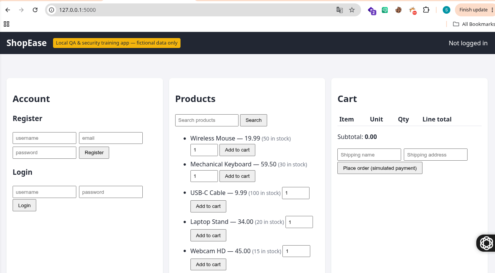 | Logged-out home page, product list and empty cart |
| E02 Product search | 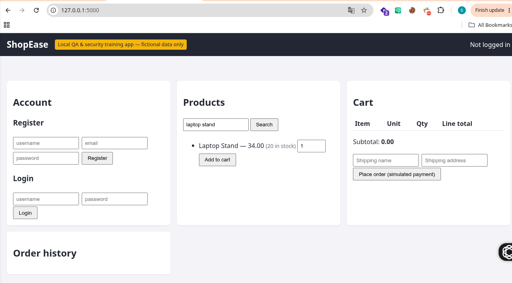 | Search `laptop stand` returns one product |
| E03 Registration | 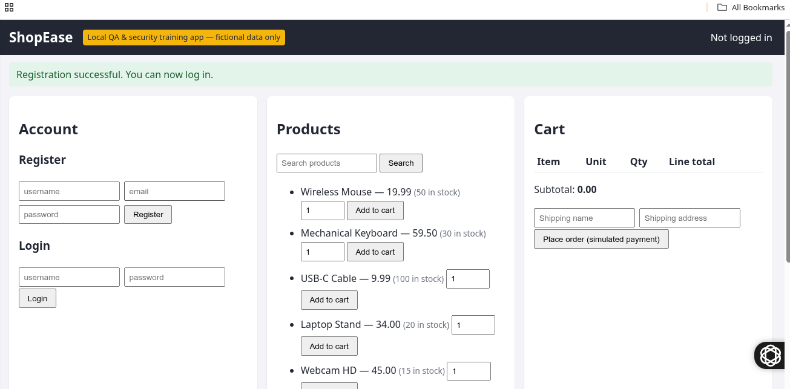 | "Registration successful" message |
| E03 Login | 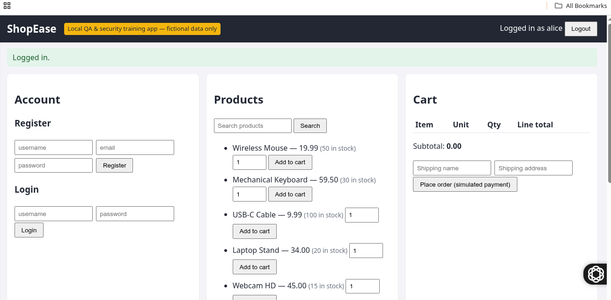 | "Logged in as alice" |
| E04 Cart update | 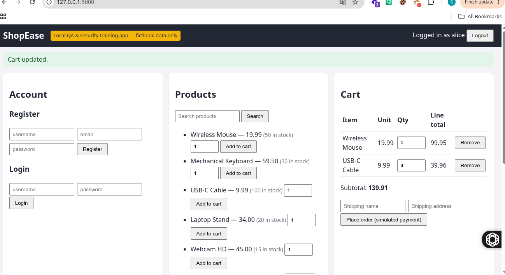 | Valid quantity updates, subtotal 139.91 (no rejected quantity shown) |
| E05 Checkout form (sanitized) | 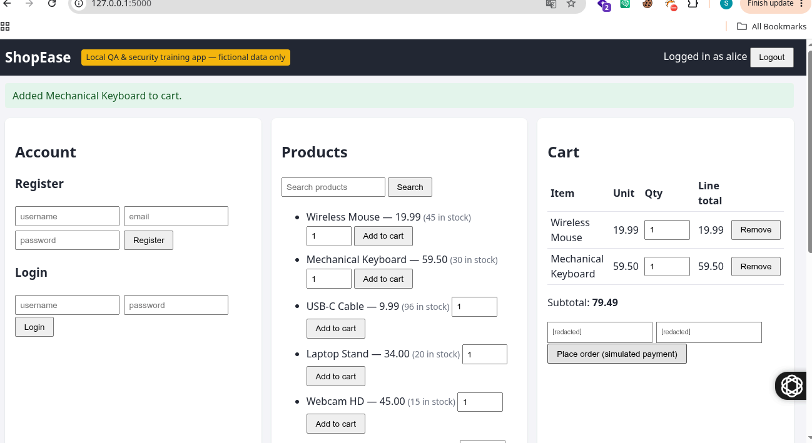 | Cart and shipping form before submission; shipping data redacted |
| E06 Order history | 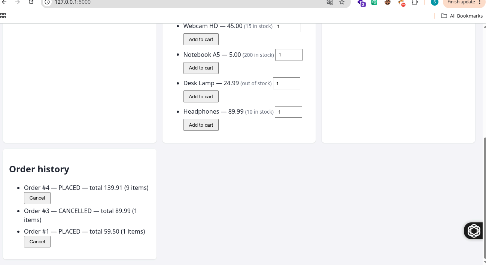 | Orders #4 PLACED, #3 CANCELLED, #1 PLACED |
| E07 pytest | 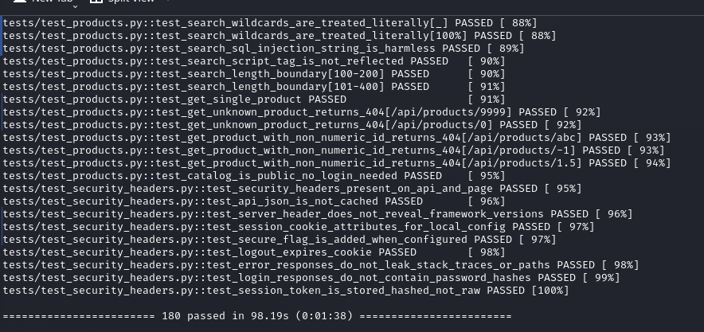 | `180 passed in 98.19s` (tail of output) |
| E08 Postman (sanitized) | 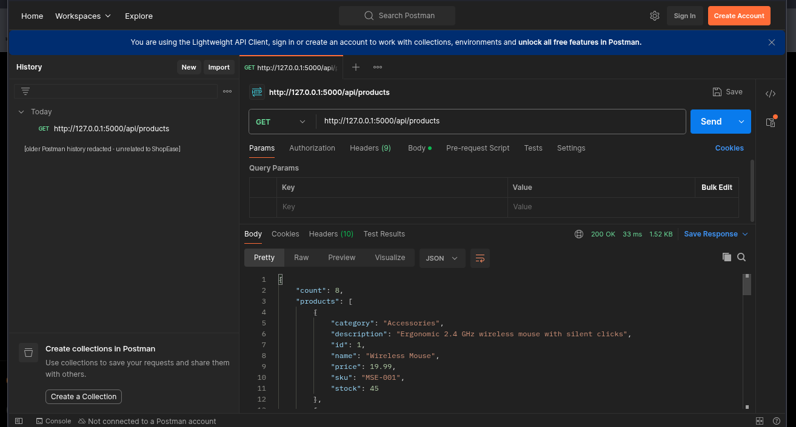 | `GET /api/products` -> 200 OK |
| E09 Price tampering | 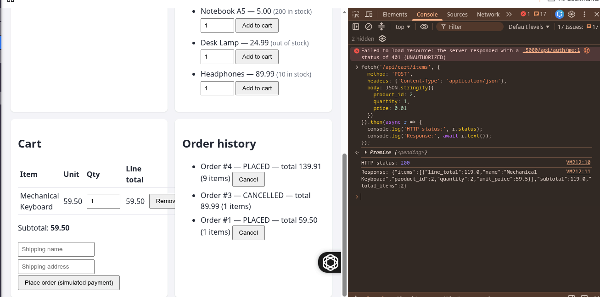 | Client price 0.01 ignored, server price 59.5 used |
| E10 Authorization | 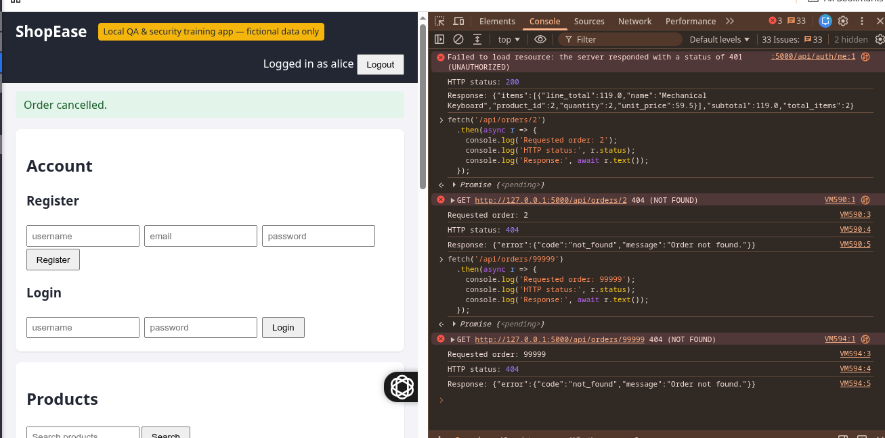 | Order 2 and 99999 both return identical 404 bodies for alice |
| E12 Security headers | 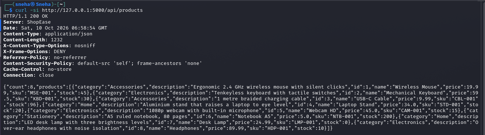 | `curl -si` showing the response headers |

## Test results (verified execution only)
Historical and latest results are kept apart. Nothing below is simulated.

| Item | Result | Basis |
|---|---|---|
| **pytest, historical run** (before the BUG-002 patch) | **180 passed, 0 failed** in 98.19 s | Real log `screenshots/pytest-output.txt` and screenshot E07. Python 3.14.6, pytest 8.4.2. Date and commit not recorded. |
| **pytest, latest run (after the BUG-002 patch)** | **185 passed, 0 failed** in 100.00 s (targeted `tests/test_id_range.py`: 5 passed in 2.84 s) | Real log `screenshots/pytest-output-after-bug002.txt`; Python 3.14.6, pytest 8.4.2, pluggy 1.6.0; run date 12 Oct 2026 (pytest prints no date; this is the date of the same-session `curl` response header, 05:42 GMT); commit not recorded (folder was not yet a Git repository). |
| Manual UI cases (24), browser | **0 Pass / 0 Fail / 24 Not Run** | Screenshots give partial evidence for 12 cases, none for 12 |
| Manual + security cases replayed at API level (scripted HTTP, `scripts/replay_manual_cases.py`) | **42 PASS, 0 FAIL** (24 TC + 17 SEC + BUG-002 regression), run on 2026-10-10 in a sandbox and again on the author's machine (Python 3.14.6) | `docs/evidence/api-replay-output.txt`. Not pytest, not Postman, not a browser. A control run on the pre-patch code gave 41 PASS + 1 FAIL. |
| Security cases (17), manual evidence | 1 Pass (SEC-HDR-001), 16 Not Run | Screenshot E12 shows all expected headers |
| SQL integrity checks on the tester's local DB copy | 0 mismatches, 0 orphans, 0 FK violations | `docs/evidence/sql-real-db-check.txt` |
| Postman collection (45 requests) | **Not Run** | Only one manual `GET /api/products` is evidenced |
| Defects | BUG-001 fixed; **BUG-002 fixed and verified** (5 regression tests + full suite 185 passed, manual HTTP check 404/404/200); BUG-003 open (cosmetic "(1 items)") | `docs/bug-reports.md` |

Details and status rules: [`docs/test-execution-report.md`](docs/test-execution-report.md).

## Known limitations and untested areas
- Small, simple app: one currency, no real payments, email, password reset or HTTPS; Flask development server on plain HTTP; session cookie intentionally has no `Secure` flag locally.
- No UI automation; the JavaScript front end was only observed manually.
- Not tested: CSRF, rate limiting/brute force, TLS, concurrency, dependency vulnerabilities, load. No scanner or dependency audit was run.
- Browser evidence for most manual cases is incomplete (see the execution report and evidence index); the API-level replay covers behaviour but not the UI.
- Known open items: BUG-003 (cosmetic) and observations OBS-01..03 in the execution report.

## Key learning outcomes
- Designing tests with equivalence partitioning and boundary value analysis.
- Writing reproducible bug reports and judging severity versus priority.
- Testing the API directly because UI validation can be bypassed; asserting side effects in the database.
- Writing isolated, repeatable automated tests (fresh database and server per test).
- Testing authentication, session and authorization controls, and separating confirmed findings from potential risks.
- Documenting evidence honestly, including its limits.

## Responsible-testing scope
Test only this local instance, or systems you own or have written permission to test. Do not apply these techniques to public websites or third-party systems.

## Documentation map
`docs/test-plan.md` - `docs/test-scenarios.md` - `docs/test-cases.md` - `docs/test-execution-report.md` - `docs/evidence-index.md` - `docs/bug-reports.md` - `docs/security-test-cases.md` - `docs/security-test-report.md` - `docs/security-findings-template.md` - `docs/api-testing-guide.md` - `docs/sql-validation.md` - `docs/browser-devtools-guide.md` - `docs/regression-checklist.md` - `docs/severity-priority-matrix.md` - `docs/qa-interview-notes.md` - GitHub/LinkedIn/interview guides.

## Troubleshooting
| Problem | Fix |
|---|---|
| `externally-managed-environment` | Use the virtual environment (`python3 -m venv .venv && source .venv/bin/activate`) |
| `ensurepip is not available` | `sudo apt install python3-venv` |
| `ModuleNotFoundError: flask` or `app` | Activate the venv and run from the repository root |
| `pytest: command not found` | `pip install -r requirements.txt` in the venv, or `python -m pytest -v` |
| `Database not found` | `python -m app.init_db --reset` |
| `Address already in use` | `SHOPEASE_PORT=5001 python run.py` (update `baseUrl` in Postman) |

License: MIT (`LICENSE`).
